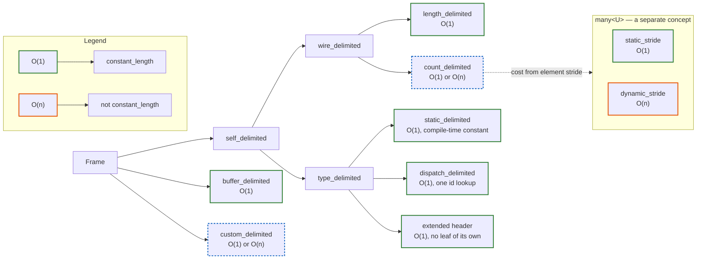

# Frame Delimiting: Final Design Decisions

> Companion to [frame-delimiting.md](frame-delimiting.md). Records the resolved forks and
> replaces the Open Questions section of that document on the listed points.

---

## Concept Hierarchy



Two **orthogonal** axes classify a frame — a mechanism axis and a cost axis. They compose; neither
is a subset of the other (an earlier draft made `self_delimited` a subset of the cost axis — that
is the bug this revision fixes).

- **Axis A — `self_delimited` (mechanism):** can the frame find its own end from its own bytes
  (header + body), or must the caller's buffer bound it? Cost is irrelevant here. `buffer_delimited`
  is the only category that is *not* `self_delimited`: it is bounded by the span handed in, so it
  knows its size but cannot self-identify its end within a stream. `custom_delimited` is a top-level
  escape hatch (a user policy); it declares its own answers on both axes.
- **Axis B — `constant_length` (cost):** is `rbe::frames::length(f)` O(1)? Analogous to
  `std::ranges::sized_range`. A frame that is not `constant_length` still has a well-defined length
  via `rbe::frames::distance(f)`, computed in O(n). The `_delimited` suffix is reserved for the
  mechanism axis; `constant_length` names the cost axis so the two never read as alternatives in one
  list.

The axes are independent:

|  | `constant_length` (O(1)) | not `constant_length` (O(n)) |
|---|---|---|
| **`self_delimited`** | `length_delimited`, `type_delimited`/`static_delimited`, `count_delimited` over a static-stride `many` | `count_delimited` over a dynamic-stride `many` |
| **buffer-bounded** | `buffer_delimited` | — (impossible) |

The bottom-right cell is empty: a buffer-bounded frame's length *is* the span size, so it is always
O(1). Cost therefore only varies **within** `self_delimited`, and today the only not-`constant_length`
case is a `count_delimited` frame whose `many<U>` has a variable element stride. `custom_delimited`
sits outside the table: its policy declares whether it is `constant_length`.

`static_stride` / `dynamic_stride` are **`many<U>` concepts, not frame concepts** — they describe the
element stride (whether `wire_size_of<U>` is a compile-time constant). A `count_delimited` frame
(`frame<H, many<U>>`) inherits its cost from them: `constant_length` iff its `many` is `static_stride`.

| Concept | `self_delimited` | `constant_length` | nestable in `many<T>` |
|---|---|---|---|
| `length_delimited` | yes | yes | yes |
| `type_delimited` / `static_delimited` | yes | yes | yes |
| `count_delimited` (`frame<H, many<U>>`) | yes | iff `many<U>` is `static_stride` | yes¹ |
| `buffer_delimited` | no | yes | no |
| `custom_delimited` | per policy | per policy | iff `self_delimited` |

¹ Over a `dynamic_stride` `many`, a `count_delimited` frame is still `self_delimited`, so it may nest
in an outer `many` — at O(n) per element.

`many<T>` requires `self_delimited<T>` — the **mechanism** axis, not `constant_length`. Each element
only needs to find its own end; it need not do so in O(1). That is why a `buffer_delimited` frame is
excluded (it is `constant_length` but consumes the whole remaining buffer, so it cannot be one
element among many), while a `count_delimited` element over a dynamic-stride `many` *is* admitted
(it finds its own end, at O(n) per element). `rbe::frames::length(f)` requires `constant_length<F>`; `rbe::frames::distance(f)` is
always valid.

Not drawn in the diagram, but classifying cleanly into the cells above: **dispatch** (an id selecting
among statically-sized alternatives) is a `type_delimited`, `constant_length` case; **`terminated_by`**
(a sentinel scan — Fork 1) is `self_delimited` but not `constant_length`, joining the dynamic-stride
`count_delimited` case.

---

## Resolved Forks

### Fork 1 — Extent customization point

**Decision: 1a as primary seam + 1c as escape hatch. 1e deferred.**

- **1a — Extent policy as third template parameter** (primary):

  ```cpp
  dsrl::frame<H, P>                          // default: header_extent
  dsrl::frame<H, P, terminated_by<'\n'>>     // cboe TOP
  dsrl::frame<H, P, body_length<4, 2>>       // length field in payload body
  ```

  The policy is a function object called as `E{}(hdr_view, rest)` returning
  `std::expected<size_type, rbe::error>`. It also declares its axis-A category via
  `E::delimiting`, which is the answer to Fork 6.

- **1c — Hand-written view on `base_frame`** (escape hatch): survives for frames that abandon
  the `header + payload` shape entirely (e.g. a variable-width header). Requires the
  `static constexpr bool self_delimiting` opt-in so the classifier can see it.

- **1e — Declarative annotation** (`[[=rbe::terminated_by('\n')]]`): deferred. When
  implemented it will lower to a library-provided 1a policy, composing cleanly.

### Fork 2 — `length()` semantics and axis-B expression

**Decision: two free functions mirroring `std::ranges::size` / `std::ranges::distance`.**

```cpp
namespace rbe::frames {
    // O(1); requires constant_length<F>
    template<constant_length F>
    constexpr size_type length(F const f);

    // always valid; O(n) for non-constant_length frames
    template<frame F>
    constexpr size_type distance(F const f);
}
```

Rules:

- `buffer_delimited` frames **are** `constant_length`: `length()` returns the size of the span
  handed in. The semantic is "I am bounded by the buffer you gave me; that boundary is
  known O(1)." Removing `length()` from them would surprise users.
- The member `.length()` is **removed** from `dsrl::frame` (or constrained away for
  non-`constant_length` types). Callers migrate to `rbe::frames::length(f)` or
  `rbe::frames::distance(f)`.
- A `count_delimited` frame over a `dynamic_stride` `many` (variable element stride) is the **only**
  case that is not `constant_length`. `rbe::frames::distance(f)` walks the elements in that case. Note
  the element requirement for `many<T>` is `self_delimited<T>`, **not** `constant_length<T>`: an
  element only needs to find its own end, so such a frame may itself nest (at O(n) per element).

### Fork 3 — The counted case

**Decision: 3b only. 3c deferred.**

The frame concept is a single `count_delimited` = `frame<H, many<U>>`; the O(1)/O(n) split is a
property of the `many<U>`, not two frame types:

- **static-stride `many<U>`** (3b): `wire_size_of<U>` is a compile-time constant. The `count_delimited`
  frame is `self_delimited` and `constant_length`:
  `rbe::frames::length(f)` = `header().length() + hdr.count() × wire_size_of<U>`.

- **dynamic-stride `many<U>`** (variable-stride U): U has no static stride. The frame is still
  `self_delimited` — the count is on the wire, so it finds its own end — but **not** `constant_length`:
  only `rbe::frames::distance(f)` is available, and it walks all elements. The limitation lives on the
  `many` (`static_stride` vs `dynamic_stride`), so no separately named frame concept is needed.

- **3c** (eager walk for variable-stride): deferred. When implemented it will make a `dynamic_stride`
  `many` opt in to `constant_length` at construction cost, likely via a future `random_access_many<U>`
  or an explicit `counted_extent` policy. Not part of this iteration.

- `many` continues to be handed the element count from the header in step 3
  (no behaviour change to the existing test coverage).

### Fork 4 — Result type of the extent rule (step 2)

**Decision: `std::expected<size_type, rbe::error>`.**

The project already intends to replace all `std::optional` returns with `std::expected`.
The error type is the **library-wide `rbe::error`** (or whatever the unified error type
becomes), not a dedicated `extent_error` enum. The incomplete/malformed distinction is
carried as error codes within that type. Propagation scope: step 2 and `frame::make`;
propagation to `header::make`, `any::make` and the deserialize entry points is a
separate, subsequent change.

### Fork 5 — `many`'s stop reason

**Decision: `done()` stays as bool; add `status()` returning an enum; retire `has_seen_partial()`.**

```cpp
enum class many_status {
    running,        // more elements may follow
    consumed,       // buffer exhausted cleanly
    count_reached,  // payload_count satisfied; bytes may remain in buffer
    incomplete,     // buffer ends mid-frame — wait for more data
    malformed,      // no continuation can recover — resync required
};

bool       done()   const;  // status() != running
many_status status() const; // replaces has_seen_partial()
```

`has_seen_partial()` is removed; callers migrate to `status() == many_status::incomplete`.
`many` also gains `consumed()` (bytes eaten so far), which is what a `counted_extent`
rule (3c, when implemented) would call, and which makes `many::as_span()` / `data()`
mean the same thing they mean on `frame` and `proxy`.

### Fork 6 — How the classifier learns a custom rule's axis-A category

**Decision: tentatively 6b (policy declares it); final answer deferred until 1a is implemented.**

Under 1a the policy type carries a `static constexpr delimiting_kind delimiting` member.
`payload_extent_of<H, P, E>` reads it. No separate opt-in is needed on the vocabulary
type, which closes the accidental-self-delimiting bug (#4) for free.

Independently: `is_self_delimiting()` must enumerate every `delimiting_kind` enumerator
explicitly (no `!= buffer_end` fallthrough — bug #5), and `payload_extent_of` must test
`is_any` / `is_many` before `wirable` (bug #6).

### Fork 7 — Extent validation

**Decision: 7c — wide path reports, narrow path asserts.**

This is the existing house style:

| Path | Validates how |
|---|---|
| `frame::make` (wide) | returns `unexpected(rbe::error::…)` if extent out of range or frame length zero |
| `frame::resolve` / constructor (narrow) | `assert(n <= rest.size() && header.length() + n > 0)` in hardened builds |
| `many::next()` | always guards against a non-advancing step (infinite loop) |

---

## The Extent Rule Contract (unchanged from proposal)

Laws L1–L7 from the proposal document stand as written. Summary:

| Law | Requirement |
|---|---|
| L1 — Purity | result depends only on header bytes + `rest` bytes |
| L2 — Prefix stability | appending bytes never moves a found boundary |
| L3 — Range | `0 ≤ n ≤ rest.size()`, frame length > 0 |
| L4 — Three states | incomplete / malformed / extent, with clear semantics |
| L5 — Extent is authority | `payload_span()` = full `n`; `payload().as_span()` may be narrower |
| L6 — Id independence | recommended; violating it inherits dispatch failure modes |
| L7 — Declared category matches | a rule consulting `rest.size()` is not self-delimiting |

---

## Naming Resolutions

| Old name | New name | Reason |
|---|---|---|
| enum `payload_extent` | `delimiting_kind` | avoids clash with function of the same name (#8) |
| function `payload_extent` | `payload_bounds` or `extent_of` | avoids clash with enum (#8) |
| `has_seen_partial()` | `status() == many_status::incomplete` | explicit stop reason (#9) |
| `sized_frame` / `measurable_frame` | `constant_length` | one name for the cost axis; keeps `_delimited` for the mechanism axis |
| `self_delimiting_frame` | `self_delimited` | mechanism axis only; no longer a subset of the cost axis |
| `explicitly_delimited_frame` | `length_delimited` | names the mechanism (length field on wire) |
| `implicitly_delimited_frame` | `type_delimited` / `static_delimited` | extent comes from the static type |
| `counted_delimited_frame` / `counted_frame` | `count_delimited` (frame) | one frame concept; the `static_stride` / `dynamic_stride` split is a `many<U>` property that decides its cost, not two frame types |

---

## Amendments from the implementation (2026-10-12)

Implementing the two recursive predicates (`self_delimited`, `static_delimited`) turned up four points
this document got wrong or left implicit. The code now reflects the amended version.

### A1 — `constant_length` is a recursive walk, not the union of the O(1) leaves

Two frames are O(1) without matching any leaf named above:

- **An extended header.** A header annotated `rbe::header_length` declares *its own* length on the wire
  and may be longer than `wire_size_of<header_type>()`. `frame<WithHeaderLength, StaticPayload>` is
  therefore `self_delimited` and `type_delimited`, resolves in O(1), and is *not* a compile-time
  constant — so it is not `static_delimited` and it is not `dispatch_delimited` either.
- **A nested frame.** The cost of a frame is the cost of its whole nesting chain, not of its outermost
  mechanism: an outer frame with no length field over an inner count-delimited run is O(n) however the
  outer header reads.

Both break a union-of-leaves definition, and both are answered by the same shape as `is_self_delimiting`:
`rbe::detail::is_constant_length<T>()`, recursive through `nested_frame`, every `payload_extent`
enumerator named explicitly so a new mechanism has to declare its cost instead of inheriting O(1). The
mechanism leaves stay as the structural vocabulary; the cost axis is computed, not enumerated.

It follows that `constant_length` holds for **every** frame the library can form today: every mechanism
implemented so far — a wire field, an id lookup, a static size, the buffer size — is O(1). The axis only
starts to discriminate when the counted case lands (A3).

### A2 — `dispatch_delimited` is a leaf of its own

`type_delimited` splits in two, and the diagram above was missing the second: an `any` payload resolves
its length from the id, which is O(1) but a *runtime* value. `static_delimited` means a compile-time
constant, so the two are disjoint, and `rbe::frames::static_length<T>` (the constant, in bytes) exists
only for the first. The pre-existing `rbe::detail::is_dispatch_delimited` already walked the nesting
chain for this; it is now exposed as `rbe::frames::dispatch_delimited`.

### A3 — The counted case cannot land before Fork 2

`count_delimited` as specified (self-delimiting, O(1) over a `static_stride` run) needs a
`payload_extent` enumerator of its own, which flips `frame<HeaderWithCount, many<U>>` from
`buffer_delimited` to `self_delimited`. That flip is not local to the classification:
`dsrl::frame::length()` would then fall through to `header().length() + payload_size(many)`, and a
`dynamic_stride` run has no O(1) answer to give — which is exactly what `rbe::frames::distance` is for.
So the order is **Fork 2 first, then Fork 3b**. Until then `count_field_delimited` and
`static_stride_delimited` are well-formed concepts that match no type, like `custom_delimited`; the
`static_assert(rbe::buffer_delimited_frame<many_frame>)` in `tests/runtime/test_dsrl_frame.cpp` is the
marker for the flip.

### A4 — `static_stride` / `dynamic_stride` need an element alias

They are `many<U>` concepts as decided, which means reaching `U` from the `many` at any level. The draft
spelled it `frame_payload_t<T>::value_type`, which exists on neither `rbe::many` (it had no alias at all)
nor `dsrl::many` (`value_type` is on its iterator; the element is `frame_type`). Both now spell the
element `frame_type`, reached through `rbe::many_element_t<M>`, next to `frame_header_t` /
`frame_payload_t` in `frame_concepts.hpp`.

### Also noted, not acted on

An explicitly empty payload is now `static_size` (zero bytes) rather than `buffer_end`, so a header-only
frame is `static_delimited` instead of swallowing the rest of the buffer. It is only reachable at the
lowered level, though: `rbe::frame_payload` admits `frame_wirable` (so, `explicitly_empty`) while
`rbe::frame_serder_payload` requires `wirable or serder_traits`, which rejects it, so
`rbe::frame<H, Empty>` is ill-formed and `dsrl::frame<H, Empty>` is not. That inconsistency is §10
(header-only messages), not this document.

---

## Open Items (not resolved here)

- **OQ-6b final confirmation**: implement 1a first; confirm policy-declared category is
  sufficient before closing 6.
- **OQ-8 — `same_extent_when_lowered` invariant**: must be restated now that the policy
  lives at one level only.
- **OQ-9 — Length units for `counted`**: `count × wire_size_of<U>` is in bytes today only
  if `wire_size_of` is in bytes; document the unit contract before shipping 3b.
- **1e — Declarative terminator annotation**: future work, lowers to a 1a policy.
- **3c — `random_access_many<U>`** for variable-stride counted frames: future work.
- **Fork 3b ordering**: blocked on Fork 2, see [A3](#a3--the-counted-case-cannot-land-before-fork-2).
- **Unified `rbe::error` type**: prerequisite for Fork 4 propagation beyond step 2.
- **Diagram placement for `dispatch` and `terminated_by`**: both classify cleanly (dispatch →
  `type_delimited`/`constant_length`; `terminated_by` → `self_delimited`, not `constant_length`) but
  are not yet drawn as nodes in the Concept Hierarchy diagram — carried as prose for now.
