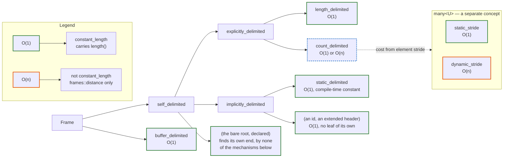

# Frame Delimiting: Final Design Decisions

> Companion to [frame-delimiting.md](frame-delimiting.md). Records the forks, their state and the
> amendments the implementation forced, and replaces the Open Questions section of that document on the
> listed points.

---

## Concept Hierarchy



Two **orthogonal** axes classify a frame — a mechanism axis and a cost axis. They compose; neither
is a subset of the other (an earlier draft made `self_delimited` a subset of the cost axis — that
is the bug this revision fixes).

- **Axis A — `self_delimited` (mechanism):** can the frame find its own end from its own bytes
  (header + body), or must the caller's buffer bound it? Cost is irrelevant here. `buffer_delimited`
  is the only category that is *not* `self_delimited`: it is bounded by the span handed in, so it
  knows its size but cannot self-identify its end within a stream. There is no third root: a frame
  that resolves its own length in code is the first answer, and it says so by declaring
  `self_delimited_tag`, the bare root (see [A8](#a8--custom_delimited-is-gone-the-bare-root-is-the-escape-hatch)).
- **Axis B — `constant_length` (cost):** can the frame's extent be had in O(1)? The answer is the frame's
  own, and it gives it by **carrying a `length()` or not**: the member exists exactly where it is O(1), so
  the concept detects rather than believes, as `std::ranges::sized_range` does. A frame without one still
  has a well-defined extent, it just costs a walk, and `rbe::frames::distance(f)` is the spelling that
  says so. The `_delimited` suffix is reserved for the mechanism axis; `constant_length` names the cost
  axis so the two never read as alternatives in one list. See
  [A13](#a13--length-exists-only-where-it-is-o1-which-makes-the-axis-a-detection).

The axes are independent:

|  | `constant_length` (O(1)) | not `constant_length` (O(n)) |
|---|---|---|
| **`self_delimited`** | `length_delimited`, `implicitly_delimited`/`static_delimited`, `count_delimited` over a static-stride `many`, a declared bare root | `count_delimited` over a dynamic-stride `many` |
| **buffer-bounded** | `buffer_delimited` | — (impossible) |

The bottom-right cell is empty: a buffer-bounded frame's length *is* the span size, so it is always
O(1). Cost therefore only varies **within** `self_delimited`, and there is exactly one
not-`constant_length` case: a `count_delimited` frame whose `many<U>` has a variable element stride. It is
reachable and inhabited — `aquis::packet` is one — and such a frame **has no `length()` at all**
([A13](#a13--length-exists-only-where-it-is-o1-which-makes-the-axis-a-detection)). A frame that resolves
itself in code is `constant_length` when it carries the member: `cboe::top::line_view` does, because its
LF scan happens in `make()` and `length()` returns the stored result.

`static_stride` / `dynamic_stride` are **`many<U>` concepts, not frame concepts** — they describe the
element stride (whether `wire_size_of<U>` is a compile-time constant). A `count_delimited` frame
(`frame<H, many<U>>`) inherits its cost from them: `constant_length` iff its `many` is `static_stride`.

| Concept | `self_delimited` | `constant_length` | nestable in `many<T>` |
|---|---|---|---|
| `length_delimited` | yes | yes | yes |
| `implicitly_delimited` / `static_delimited` | yes | yes | yes |
| `count_delimited` (`frame<H, many<U>>`) | yes | iff `many<U>` is `static_stride`, and only that case is deduced | yes¹ |
| `buffer_delimited` | no | yes | no |
| bare `self_delimited` (declared) | yes | presumed yes | yes |

¹ Over a `dynamic_stride` `many`, a `count_delimited` frame is still `self_delimited`, so it may nest
in an outer `many` — at O(n) per element.

`many<T>` requires `self_delimited<T>` **and** `constant_length<T>`: the element has to find its own end,
and the step that advances the run *is* `length()`, so it has to find it in O(1). A `buffer_delimited`
frame is excluded for the first reason (it consumes the whole remaining buffer, so it cannot be one
element among many) and a dynamic-stride `count_delimited` frame for the second — it has no `length()`, so
a `many` of it would have had to walk per element, which is an O(n²) run nobody asked for. An earlier
revision of this document admitted it ("an element only needs to find its own end, it need not do so in
O(1)"), which was written while every frame had a `length()` to advance by; see
[A13](#a13--length-exists-only-where-it-is-o1-which-makes-the-axis-a-detection).

Both axes are **tag types**, not predicates: the mechanism hierarchy above is a derivation hierarchy of
`*_delimited_tag` types, every frame carries the one it belongs to as a `delimiting_concept` member, and
every concept in this document is one `std::derived_from` over it. The cost axis is not a tag: it is a
walk down the nesting chain, because a tag speaks only for the frame that carries it. See
[A5](#a5--the-mechanism-axis-is-a-tag-hierarchy-the-cost-axis-is-a-walk).

**An id** (an `rbe::frames::any` payload selecting among alternatives) and **an extended header** are
both `implicitly_delimited` and `constant_length` without being `static_delimited`: O(1), settled at
runtime, no leaf of their own. **A sentinel scan** (`terminated_by`, Fork 1) declares the bare
`self_delimited_tag`: it finds its own end by none of the mechanisms the refinements name. The tag says
nothing about cost because no tag does — the scan is `make()`'s to pay, and `length()` returns what
`make()` stored.

---

## Forks

| Fork | Decision | State |
|---|---|---|
| 1 — extent customization point | **revised**: 1c is the seam, 1a/1e deferred | 1c implemented |
| 2 — `length()` / `distance()` | **resolved 2026-10-13**: `length` exists only where it is O(1), `distance` always | implemented |
| 3 — the counted case | **3b landed 2026-10-13**, both strides; 3c is the `many` category | implemented |
| 4 — `std::expected` in step 2 | decided | not started |
| 5 — `many`'s stop reason | decided | not started |
| 6 — how the classifier learns a custom category | **resolved**, not as 6b | implemented |
| 7 — extent validation | decided | half: reports failure, not which (needs 4) |


### Fork 1 — Extent customization point

**Decision (revised 2026-10-12): 1c is the seam. 1a and 1e deferred to future work.**

- **1c — Hand-written view on `base_frame`** (implemented, and the only seam today): a frame that
  resolves its own length derives from `rbe::frames::dsrl::base_frame`, supplies the two primitives
  (`make()` and `length()`) and **declares its category**:

  ```cpp
  class line_view : public rbe::frames::dsrl::base_frame<Header, messages::dsrl_type> {
  public:
    using delimiting_concept = rbe::frames::self_delimited_tag;  // the LF scan: finds its own end
    static constexpr auto make(buffer_type) -> std::optional<line_view>;
    constexpr auto length() const -> size_type;
  };
  ```

  The declaration is **not optional**: `rbe::frames::is_frame` requires a `delimiting_concept`, so a
  custom frame cannot be silently classified by its shape — which is what closes bug #4
  (see [A6](#a6--is_frame-requires-the-category-which-replaces-the-self_delimiting-opt-in)). It replaces
  the `static constexpr bool self_delimiting` opt-in this document originally specified: saying *which*
  category is strictly more than saying yes/no, and it is the same channel the library's own frames use.

  `base_frame` deliberately declares **no** default tag, so a derived frame has nothing to inherit and
  has to state its category, exactly as it has to supply its own `make()` and `length()`.

  **What it declares when no leaf fits.** The tags are a derivation hierarchy, so the interior nodes are
  usable answers — that is the whole reason they are tags and not predicates
  ([A5](#a5--the-mechanism-axis-is-a-tag-hierarchy-the-cost-axis-is-a-walk)). A custom frame picks the
  most precise node it can honestly claim, **on the mechanism axis only**: a tag answers who knows where
  the frame ends and by what, never what the answer costs
  ([A11](#a11--the-cost-axis-is-deduced-only-never-declared)).

  | Declares | Means |
  |---|---|
  | `static_delimited_tag` | every byte fixed by the types |
  | `length_delimited_tag` | a length field on the wire, wherever it sits (a body length, not only a header one) |
  | `count_delimited_tag` | a count on the wire bounds a run |
  | `implicitly_delimited_tag` | the types settle it, with no wire field and no compile-time constant — out-of-band state, a session parameter, an id |
  | `explicitly_delimited_tag` | a wire field settles it, but in neither leaf shape |
  | `self_delimited_tag` | finds its own end, by none of the mechanisms above — a sentinel scan |
  | `buffer_delimited_tag` | the buffer bounds it |

  The bare root is the honest answer whenever none of the refinements describes the mechanism, and the
  only one a frame should declare when it is not sure. What it costs to resolve is not asked: the frame
  signs the same `length()` contract as every other — resolve once in `make()`, keep the result — and the
  library presumes it honoured.

  The one case the hierarchy cannot express today is **"a compile-time constant whose value the library
  cannot compute"** — a fixed-width frame over an opaque payload. `static_delimited_tag` static-asserts
  that `detail::static_frame_size<T>()` can add up the parts, so such a frame has to settle for
  `implicitly_delimited_tag` and lose `static_length<T>` (and with it `static_stride` for a `many` of it).
  If a real protocol needs it, the fix is the same declared-over-deduced pattern one level down: let the
  frame declare the constant (`static constexpr size_type static_length`) and have `static_frame_size`
  prefer it over the computation. Not implemented — no case for it yet.

- **1a — Extent policy as third template parameter** (deferred): `dsrl::frame<H, P, terminated_by<'\n'>>`
  would turn the ~40 hand-written lines of `line_view` into one declaration, with the policy declaring
  the category (`E::delimiting`) instead of the frame. It is the main thing still missing for custom
  frames, and it is additive: it does not change how 1c frames are classified, it only removes the
  boilerplate. Not scheduled.

- **1e — Declarative annotation** (`[[=rbe::terminated_by('\n')]]`): deferred. When implemented it
  lowers to a 1a policy, so it is blocked on 1a.

### Fork 2 — `length()` semantics and axis-B expression

**Decision (2026-10-13): `length` exists exactly where the extent is O(1), because the member does.
`distance` answers for every frame. Implemented in `rbe/frames/length.hpp`.**

```cpp
namespace rbe::frames {
    inline constexpr length_fn   length {};    // O(1). Exists only for a frame that carries length()
    inline constexpr distance_fn distance {};  // every frame. Walks when that is the only way

    template<typename F> concept constant_length = /* does it carry length()? */;
}
```

Two earlier drafts of this fork are worth keeping, because the third one is what their failure modes add
up to:

1. **`length` gated on `constant_length`, the member left mandatory.** The gate was the point, the way
   `std::ranges::size` refuses what `.size()` would have answered. But a gate the member can bypass
   protects nothing, and `.length()` was one `.` away.
2. **Neither function gated, the O(1)-ness of `length()` a documented contract.** Honest, unverifiable,
   and it left a real bug standing: a counted run of variable-size elements is *not* bounded by the buffer
   it arrived in, and `length()` was returning the buffer size for it.

So: **`length()` is simply absent where it cannot be O(1)**, and everything derived from it goes with it
(`as_span()`, `payload_span()`, being an element of a `many`; `flatten()` is not derived from it — it
walks `header()` and `payload()` — so it stays). Nothing to gate, nothing to
promise, nothing to bypass — the member either is there or is not, and `constant_length` detects which.
That is `std::ranges::sized_range` exactly, and it is the shape
[A13](#a13--length-exists-only-where-it-is-o1-which-makes-the-axis-a-detection) explains, including the
one thing this document argued against twice before accepting it.

Rules:

- `buffer_delimited` frames **are** `constant_length`: `length()` returns the size of the span handed
  in. The semantic is "I am bounded by the buffer you gave me; that boundary is known O(1)".
- A `count_delimited` frame over a `dynamic_stride` `many` is the **only** case that is not
  `constant_length`. That is the whole informational content of the axis, and it is deduced.
- The element requirement for `many<T>` is `self_delimited<T>` **and** `constant_length<T>`: the run
  advances by the element's `length()`, so an element without one is not admissible. This is what keeps a
  `many` from quietly becoming O(n²).
- `length()` is O(1) wherever it exists, and `rbe::frames::dsrl::is_frame` no longer requires it. For the
  library's own frames its existence is deduced (`dsrl::frame::length()` is constrained on
  `rbe::detail::is_constant_length<frame>()`); for a hand-written frame, writing one is the claim and not
  writing one is the opposite. `base_frame` keeps the payload view it resolved in `make()`, which is what
  makes the claim true for everything the library builds.
- `distance` is an algorithm and not a second customization point, the way `ranges::distance` is not one:
  `length()` first, then a `distance()` member, then a `frame_distance(f)` found by ADL, then the
  library's own walk (the header plus the measured elements of the run). The ADL hook exists where
  `ranges::distance` has none because a frame does not always carry something to walk the way a range
  carries `++`.

**Still no `disable_constant_length`, and still no declared cost** — see
[A11](#a11--the-cost-axis-is-deduced-only-never-declared) for the shapes that were weighed and
[A13](#a13--length-exists-only-where-it-is-o1-which-makes-the-axis-a-detection) for the one that landed:
the opt-out a frame has is to not write `length()`, which is a decision taken where it belongs (in the
class, next to the resolution it describes) and in a form nothing can contradict.

**Sub-decision — the member `.length()`: kept.** The alternative was renaming the primitive
(`resolve_extent()`) so the free functions were the only public spellings. It is moot now: the member is
the claim, so it has to keep the name the claim is about.

### Fork 3 — The counted case

**Decision: 3b, both strides (2026-10-13). 3c is what is left of it.**

The frame concept is a single `count_delimited` = `frame<H, many<U>>`; the O(1)/O(n) split is a
property of the `many<U>`, not two frame types:

- **static-stride `many<U>`** (3b): `wire_size_of<U>` is a compile-time constant. The `count_delimited`
  frame is `self_delimited` and `constant_length`:
  `rbe::frames::length(f)` = `header().length() + hdr.count() × wire_size_of<U>`.

- **dynamic-stride `many<U>`** (variable-stride U): U has no static stride. The frame is still
  `self_delimited` — the count is on the wire, so it finds its own end — but **not** `constant_length`:
  the run has to be walked to know where it ends. This is the one case the cost axis exists for, and the
  only one in the whole classification: *delimited, but O(n)*. Such a frame carries **no `length()`**, and
  `frames::distance(f)` is the walk that answers for it. The limitation lives on the `many`
  (`static_stride` vs `dynamic_stride`), so no separately named frame concept is needed.

  What it must not be is `buffer_delimited`, which is what it was until 2026-10-13: the count outranks
  whatever the buffer happens to measure (the wire is the golden source), so the bytes after the last
  element are not payload however well the buffer fits. `aquis::packet` is the instance — a UDP datagram
  where the two usually coincide, which is exactly why the misclassification was invisible.

- **3c** (what is left): a `dynamic_stride` `many` opting in to `constant_length` by resolving its extent
  once, and — the other half, from the std-views reading of `many` — `many<U>` computing its **iterator
  category** from `U`, so a static-stride run is a random-access range (`size()`, `operator[]`, jump to
  element *i*) instead of input-only. Not a new type either way; see
  [A12](#a12--a-count-delimits-by-the-cheapest-means-it-has-and-many-is-one-type).

- `many` continues to be handed the element count from the header in step 3
  (no behaviour change to the existing test coverage).

**Implementation state: both strides are in** (2026-10-13; the static one landed first, see
[A12](#a12--a-count-delimits-by-the-cheapest-means-it-has-and-many-is-one-type)). Three pieces, one per
layer, and the dynamic case adds a fourth by *removing* something — it has no `length()`:

```cpp
// the deduction: rbe::detail::frame_delimiting
else if constexpr (contains_annotation<H, rbe::payload_count> and frames::is_many<P> and has_static_stride<P>())
  return ^^frames::static_stride_delimited_tag;

// step 2, the bytes: rbe::frames::dsrl::counted_extent  -> count * static_length<many_element_t<P>>
// the runtime length: dsrl::frame::length() -> header().length() + counted_extent<payload_type>(header())
```

`counted_extent` is the only place in step 2 where the payload *type* takes part at all; everything else
there reads the header. `many` is untouched: it is never asked for an extent, because the count and the
stride settle it above.

The frames that moved are the `HeaderWithCount` fixtures in the tests. **`aquis::packet` did not**: its
elements carry `rbe::frame_length` and an `any`, so the stride is dynamic and the packet stays
`buffer_delimited`, exactly as before. The visible change for a frame that did move is that it now ends
where the run ends: trailing padding is outside `length()`, `as_span()` and `payload_span()`, and a
stream of them is walked by `length()` instead of by `payload().remainder()`.

### Fork 4 — Result type of the extent rule (step 2)

**Decision: `std::expected<size_type, rbe::error>`.**

The project already intends to replace all `std::optional` returns with `std::expected`.
The error type is the **library-wide `rbe::error`** (or whatever the unified error type
becomes), not a dedicated `extent_error` enum. The incomplete/malformed distinction is
carried as error codes within that type. Propagation scope: step 2 and `frame::make`;
propagation to `header::make`, `any::make` and the deserialize entry points is a
separate, subsequent change.

### Fork 5 — `many`'s stop reason

**Decision: `done()` stays as bool; add `status()` returning an enum; retire `has_seen_partial()`.**

```cpp
enum class many_status {
    running,        // more elements may follow
    consumed,       // buffer exhausted cleanly
    count_reached,  // payload_count satisfied; bytes may remain in buffer
    incomplete,     // buffer ends mid-frame — wait for more data
    malformed,      // no continuation can recover — resync required
};

bool       done()   const;  // status() != running
many_status status() const; // replaces has_seen_partial()
```

`has_seen_partial()` is removed; callers migrate to `status() == many_status::incomplete`.
`many` also gains `consumed()` (bytes eaten so far), which is what a `counted_extent`
rule (3c, when implemented) would call, and which makes `many::as_span()` / `data()`
mean the same thing they mean on `frame` and `proxy`.

### Fork 6 — How the classifier learns a custom rule's axis-A category

**Decision: resolved (2026-10-12), but not as 6b — the frame declares it, not a policy.**

There is no policy to carry the category, because 1a is deferred. The answer is the member every frame
already has to expose:

```cpp
template<is_frame T>
using delimiting_concept_t = typename T::delimiting_concept;   // declared
template<header H, typename P>
using frame_delimiting_tag = …;                                 // deduced, what the library's frames declare
```

`rbe::frame` and `rbe::frames::dsrl::frame` declare `frame_delimiting_tag<H, P>`, the deduction from
their shape; a 1c frame declares its own and that is the end of it — there is no precedence rule to get
wrong, because there is a single channel. `is_frame` requires the member, so the accidental-self-delimiting
bug (#4) cannot occur: a frame with no stated category is not a frame.

If 1a ever lands, 6b folds in without changing this: the policy would declare `E::delimiting` and the
frame would forward it as its `delimiting_concept`.

Independently, both bugs listed here are fixed: the deduction names **every** structural case explicitly
with a `static_assert` on the fallthrough (no `!= buffer_end`, bug #5), and it tests `is_frame` / `is_any`
/ `is_many` before `wirable_payload` (bug #6).

---

### Fork 7 — Extent validation

**Decision: 7c — wide path reports, narrow path asserts.**

This is the existing house style:

| Path | Validates how |
|---|---|
| `frame::make` (wide) | returns `unexpected(rbe::error::…)` if extent out of range or frame length zero |
| `frame::resolve` / constructor (narrow) | `assert(n <= rest.size() && header.length() + n > 0)` in hardened builds |
| `many::next()` | always guards against a non-advancing step (infinite loop) |

---

## The Extent Rule Contract (unchanged from proposal)

Laws L1–L7 from the proposal document stand as written. Summary:

| Law | Requirement |
|---|---|
| L1 — Purity | result depends only on header bytes + `rest` bytes |
| L2 — Prefix stability | appending bytes never moves a found boundary |
| L3 — Range | `0 ≤ n ≤ rest.size()`, frame length > 0 |
| L4 — Three states | incomplete / malformed / extent, with clear semantics |
| L5 — Extent is authority | `payload_span()` = full `n`; `payload().as_span()` may be narrower |
| L6 — Id independence | recommended; violating it inherits dispatch failure modes |
| L7 — Declared category matches | a rule consulting `rest.size()` is not self-delimiting |

---

## Naming Resolutions

| Old name | Landed as | Reason |
|---|---|---|
| enum `payload_extent` | **gone** | the enum and its file were deleted; the deduction returns a tag directly, so the clash with the function of the same name (#8) is moot and `delimiting_kind` never existed |
| function `payload_extent` | unchanged (`rbe::frames::dsrl::payload_extent`) | it is the runtime byte-bounds helper of step 2; nothing clashes with it any more |
| `has_seen_partial()` | *not yet* `status() == many_status::incomplete` | Fork 5 is unimplemented |
| `sized_frame` / `measurable_frame` | `constant_length` | one name for the cost axis; keeps `_delimited` for the mechanism axis |
| `self_delimiting_frame` | `self_delimited` | mechanism axis only; participle, so the concept and its tag read as the same word |
| `explicitly_delimited_frame` | `explicitly_delimited` (node) + `length_delimited` (leaf) | the node says "a wire field settles it", the leaf says "in bytes" |
| `implicitly_delimited_frame` | `implicitly_delimited` (node) + `static_delimited` (leaf) | `type_delimited` was dropped: the node is the interior answer for an id or an extended header |
| `counted_delimited_frame` / `counted_frame` | `count_delimited` | one frame concept; the `static_stride` / `dynamic_stride` split is a `many<U>` property |
| `length_field_delimited` / `count_field_delimited` | `length_delimited` / `count_delimited` | `_field` was redundant with what each one documents |
| `custom_delimited` | **gone** | see [A8](#a8--custom_delimited-is-gone-the-bare-root-is-the-escape-hatch) |
| `dispatch_delimited` | **gone** | see [A7](#a7--dispatch_delimited-is-gone-reverts-a2) |

All of the above live in `rbe::frames` (see [A10](#a10--where-everything-lives-now)).

---

## Amendments from the implementation (2026-10-12)

Implementing the two recursive predicates (`self_delimited`, `static_delimited`) turned up four points
this document got wrong or left implicit. The code now reflects the amended version.

### A1 — `constant_length` is a recursive walk, not the union of the O(1) leaves

Two frames are O(1) without matching any leaf named above:

- **An extended header.** A header annotated `rbe::header_length` declares *its own* length on the wire
  and may be longer than `wire_size_of<header_type>()`. `frame<WithHeaderLength, StaticPayload>` is
  therefore `self_delimited` and `implicitly_delimited`, resolves in O(1), and is *not* a compile-time
  constant — so it is not `static_delimited`, and it has no leaf of its own at all.
- **A nested frame.** The cost of a frame is the cost of its whole nesting chain, not of its outermost
  mechanism: an outer frame with no length field over an inner count-delimited run is O(n) however the
  outer header reads.

Both break a union-of-leaves definition. The answer is `rbe::frames::detail::is_constant_length<T>()`, a
recursive walk: it reads the frame's tag, refuses the one non-O(1) tag, and otherwise recurses into a
nested payload, so one slow level settles the cost for everything above it. (This amendment originally
specified a walk over the `payload_extent` enumerators; the enum is gone, and the walk is over tags —
see [A9](#a9--payload_extent-is-gone-one-authority-for-the-classification).) The mechanism tags stay as
the structural vocabulary; the cost axis is computed, not enumerated.

It follows that `constant_length` holds for **every frame in the tree today**: every structural mechanism
— a wire field, an id lookup, a static size, the buffer size — is O(1), and a declared tag is taken at
its word ([A11](#a11--the-cost-axis-is-deduced-only-never-declared)).

That stopped being true the next day, and the walk stopped being the definition with it: Fork 3b landed
for both strides, so a counted run of variable-size elements is the first deduced frame that is not O(1),
and the public axis became the detection of `length()`
([A13](#a13--length-exists-only-where-it-is-o1-which-makes-the-axis-a-detection)). The walk described here
is still what decides whether the library's own frames expose that member, which is the whole of its job
now.

### A2 — `dispatch_delimited` is a leaf of its own ~~(superseded)~~

> **Reverted the same day — see [A7](#a7--dispatch_delimited-is-gone-reverts-a2).** Kept here because the
> observation it is built on still holds: an `any` payload resolves its length from the id, which is O(1)
> but a *runtime* value, so it is not `static_delimited`. What was wrong was giving that case a leaf of
> its own; it is the interior node, `implicitly_delimited`, together with the extended header.

### A3 — The counted case is blocked on `many`'s byte extent ~~(superseded by A12)~~

> **Superseded the same day.** The blocker was real but the fix was not needed: once only the
> static-stride half is deduced, nothing has to walk and nothing has to report a walk, so `many` never
> needs an extent of its own. Kept because the diagnosis below — that the original A3 blamed the wrong
> layer — still stands, and because the walk described here is what Fork 3c will need.

~~A3 said the order was Fork 2 first, then Fork 3b~~, on the grounds that flipping the constant sends
`dsrl::frame::length()` into `header().length() + payload_length(payload())` and a `dynamic_stride` run
"has no O(1) answer to give". The diagnosis was off by one layer: an O(n) answer is a perfectly good
answer and the concept is what reports the cost (Fork 2, resolved). What is actually missing is that
**`dsrl::many` cannot say how many bytes it occupies at all** — it has no `length()` and no `size()`, and
its `as_span()` / `data()` return `remainder()`, the rest of the buffer, because it is a consuming cursor
rather than a view with a known extent. `detail::payload_length(many)` therefore does not compile.

So 3b is unblocked by Fork 2 and blocked on giving `dsrl::many` an extent. The walk belongs in **step 2**
(`payload_extent`), not in the `many`'s constructor: a `many` is already built over whatever step 2
returns (`construct_payload` → `view {bytes, payload_count(hdr)}`), and `payload_extent<P, H>` ignores `P`
entirely today — it consults `header::delimits_payload` and otherwise hands back all of `rest`. Acting on
`P` there is the whole change, and it keeps the resolution to one pass:

| step 2, for a `many` payload | returns | cost |
|---|---|---|
| `has_count`, static stride | `rest.first(count × static_length<U>)` | O(1), nothing walked |
| `has_count`, dynamic stride | walk the `count` elements once, then `rest.first(total)` | O(n), once |
| no count | `rest`, as today | O(1) |

`many` then needs three lines and no new state: `length()` returns `data_.size_bytes()` (the bytes step 2
bounded, so O(1) for every case), and `as_span()` / `data()` stop returning `remainder()` — the cursor —
so that the `as_span() == {data(), length()}` invariant every other view honours holds here too.
`remainder()` stays for the cursor's own users (`has_seen_partial()`). `split_span` already keeps both the
whole buffer and the cursor, so nothing is recomputed.

Walking in the constructor instead would pay twice: once to resolve, once to iterate. In step 2 it is
paid once, and it is also where the wide form gets a real precondition check for free — walking the run
reveals a truncated buffer, so `try_payload_extent` can return `nullopt` from `make()` instead of leaving
it to be discovered mid-iteration by `has_seen_partial()` (Fork 7).

What stays expensive is inherent: for a dynamic-stride counted run, `make()` walks and then the reader
walks again. Nothing can locate the end of a variable-stride run without traversing it, which is what
`not constant_length` is there to announce.

Both markers this amendment named are gone: `counted_runs_are_delimited` was replaced by the annotation
and stride conditions, and the `static_assert(buffer_delimited<many_frame>)` in
`tests/runtime/test_dsrl_frame.cpp` is now `static_assert(static_stride_delimited<many_frame>)`. Every
node of the counted branch is inhabited as of 2026-10-13, the dynamic one by `aquis::packet`.

### A4 — `static_stride` / `dynamic_stride` need an element alias

They are `many<U>` concepts as decided, which means reaching `U` from the `many` at any level. The draft
spelled it `frame_payload_t<T>::value_type`, which exists on neither `rbe::many` (it had no alias at all)
nor `dsrl::many` (`value_type` is on its iterator; the element is `frame_type`). Both now spell the
element `frame_type`, reached through `rbe::frames::many_element_t<M>`, next to `header_t` / `payload_t`
in `frame_concepts.hpp`.

### A5 — The mechanism axis is a tag hierarchy, the cost axis is a walk

The concepts are no longer predicates computed from the structure on every query. The mechanism axis is a
hierarchy of **tag types that derive from one another**, the way `std::forward_iterator_tag` refines
`std::input_iterator_tag`:

```cpp
self_delimited_tag
|-- explicitly_delimited_tag
|   |-- length_delimited_tag
|   `-- count_delimited_tag
|       `-- static_stride_delimited_tag
`-- implicitly_delimited_tag
    `-- static_delimited_tag

buffer_delimited_tag
```

Three things follow, and all three were problems this document had left open:

1. **Refinement is derivation**, so every concept is one `std::derived_from` over
   `delimiting_concept_t<T>` and the hierarchy cannot drift from the concepts that read it.
2. **An interior node is a usable answer.** The extended-header case of
   [A1](#a1--constant_length-is-a-recursive-walk-not-the-union-of-the-o1-leaves) had no leaf and could
   not be named by a predicate; it is `implicitly_delimited_tag` exactly.
3. **A declaration made deep in a nesting chain reaches the outermost frame**, because the deduction
   recurses through the nested frame's *tag* rather than re-deriving from its shape. A structural walk
   cannot do that, which is what made the 1c opt-in (Fork 1) useless where it mattered.

The cost axis is deliberately **not** a tag: a tag speaks for the frame that carries it, and the cost
belongs to the whole chain. It stays a walk (`is_constant_length`), as A1 said.

Deduced by default, declared where it is not deducible: this is the `std::iterator_traits` /
`ITER_CONCEPT` shape, and the same rule std follows for ranges — detect what is structurally detectable
(`sized_range`), declare only what is not (`enable_borrowed_range`).

### A6 — `is_frame` requires the category, which replaces the `self_delimiting` opt-in

```cpp
template<typename T>
concept is_frame = requires {
  typename T::header_type;
  typename T::payload_type;
  requires header<typename T::header_type>;
  requires declares_delimiting_concept<T>;
};
```

The category is part of the frame shape, so a frame with no stated category is not a frame. That closes
bug #4 by construction and supersedes the `static constexpr bool self_delimiting` opt-in specified under
Fork 1c: a declaration that says *which* category is strictly more than one that says yes/no, and it is
the same member the library's own frames carry.

It is required as a **member**, not through `delimiting_concept_t`, because the trait is constrained on
`is_frame` and asking it here would make the concept depend on itself.

Two costs, both accepted:

- A frame written from scratch, deriving from nothing, is not a frame until it declares one. `rbe::frame`
  and `rbe::frames::dsrl::frame` deduce it, so this only bites a hand-written one — where it is the point.
- The diagnostic for a forgotten member is "does not satisfy `is_frame`", not "you forgot
  `delimiting_concept`". A `static_assert` in `many` / `frame::make` would fix that; not done.

L7 is unchanged and still a promise: nothing verifies that a declared `self_delimited_tag` does not peek
at `rest.size()`, exactly as nothing verifies `enable_borrowed_range`.

### A7 — `dispatch_delimited` is gone (reverts A2)

An `rbe::frames::any` payload now deduces `implicitly_delimited_tag`, the interior node, which already
means what the dispatch leaf meant: O(1), settled at runtime, not a compile-time constant. The leaf bought
nothing — neither `length()`, nor the cost walk, nor `many` ever asked for it — and the tag went with the
concept, since a tag no concept queries can only be read by comparing `delimiting_concept_t` by hand.

The visible consequence is in the examples: `cboe::top::message`, `nasdaq::message` and `opra::message`
assert `implicitly_delimited` instead, and the id case is documented as one of the two node-only answers.

### A8 — `custom_delimited` is gone: the bare root is the escape hatch

The category was a trap for its only client. `cboe::top::line_view` — the one custom frame in the tree —
declares `self_delimited_tag`, because its LF scan genuinely does find its own end; had it declared
`custom_delimited_tag`, which derived from nothing, it would have stopped being admissible as an element
of `rbe::frames::many`. "Custom" is provenance, not a category: the answer to *who* knows where the frame
ends is still "the frame itself".

So the bare `self_delimited_tag` is the escape hatch. It was also read, at first, as carrying a cost
claim — the root claims nothing about complexity, so `is_constant_length` returned false for it — and
that part is reverted in [A11](#a11--the-cost-axis-is-deduced-only-never-declared): it is a mechanism
answer and only that. The two clauses `and not custom_delimited<T>` on `self_delimited` /
`buffer_delimited` disappeared with the category — they had been redundant since the tags started
deriving.

### A9 — `payload_extent` is gone: one authority for the classification

`rbe/framing/detail/payload_extent.hpp` (the `payload_extent` enum, `payload_extent_of`,
`is_self_delimiting`, `is_dispatch_delimited`, `is_constant_length`, `static_frame_size`) was deleted. The
deduction in `rbe/frames/detail/frame_delimiting.hpp` reads the frame directly — the length annotations of
its header, then the category of its payload — and is the single authority on the precedence between them:
the wire is the golden source, so a header length field outranks whatever the types would answer.

With it went the five `rbe::` concepts that read it (`self_delimiting_frame`, `buffer_delimited_frame`,
`explicitly_delimited_frame`, `implicitly_delimited_frame`, `dispatch_delimited_frame`); `dsrl::many`,
`dsrl::views` and `dsrl::frame::length()` now ask `rbe::frames::`, which is how a declared category finally
reaches the runtime (the point of Fork 1c).

`rbe::frames::dsrl::payload_extent` — the function that returns the payload's **bytes** in step 2 — is a
different thing and stays.

### A10 — Where everything lives now

```
src/rbe/frames/                       (was src/rbe/framing/)
  rbe::frames::            frame, many, any, blob, is_frame, header, payload, serder,
                           the tags, frame_delimiting_tag, delimiting_concept_t,
                           self_delimited … static_length
  rbe::frames::dsrl::      frame, base_frame, many, any, header, payload_extent, …
  rbe::frames::srl::       frame, many, any
  rbe::frames::views::     many, with_ids, known_ids, unknown_ids   (+ alias rbe::views)
  rbe::frames::length / distance / constant_length          (length.hpp)
  rbe::                    deserialize, try_deserialize
  rbe::frames::detail::    the module's private machinery      (see A14)
  rbe::frames::dsrl::detail::  the lowering's own private machinery
```

The whole module is under `rbe::frames` except the two verbs. Two things could not follow and both are
hard constraints, not taste:

- **`rbe::dsrl` could not be aliased.** `namespace rbe::dsrl = rbe::frames::dsrl;` is ill-formed:
  `rbe::dsrl` is a real namespace with its own members in `src/rbe/dsrl/` (proxy, the strategy tags,
  `deserialize` for wirables), and an alias cannot share a name with it. A `using namespace` patch
  compiles but splits ADL. `rbe::views` *can* be aliased, because `rbe::frames::views` is its only home —
  which is exactly how `std::views` names `std::ranges::views`.
- **Names inside `frames::` lost the `frame_` prefix only where the namespace replaces it**:
  `header`, `payload`, `header_t`, `payload_t`, `serder_payload`, `wirable_payload`. `frame_serder` keeps
  it (it classifies a frame, like `sized_range` keeps `range`), and `is_frame` / `is_any` / `is_many` keep
  the `is_` because the bare names are the types.

### A11 — The cost axis is deduced only, never declared

> **Partly superseded on 2026-10-13 by [A13](#a13--length-exists-only-where-it-is-o1-which-makes-the-axis-a-detection).**
> Its conclusion stands — a *tag* never carries a cost claim — but its argument against detecting the cost
> from `length()` rested on `length()` being mandatory, and it no longer is. The axis is now a detection,
> which is the first bullet below, adopted rather than rejected.

The bare `self_delimited_tag` was doing two jobs: answering the mechanism question ("I find my own end,
by none of the mechanisms the refinements name") and, silently, the cost one ("and do not count me as
O(1)"), because `is_constant_length` returned false for it. That second job is removed. The branch is
gone from the walk, so a frame that declares the root is `constant_length` like any other, and the one
category the library can actually see to be O(n) — a counted run with no static stride — is the only
thing the axis reports.

Three shapes were weighed and two rejected:

- **A `disable_constant_length<T>` variable template**, the `std::disable_sized_range` transplant: pair it
  with a syntactic `constant_length<T> = requires { f.length() }` and the axis becomes `sized_range`.
  It does not transfer **while `length()` is mandatory** — which is the premise A13 removes, making the
  second half of this bullet the design and the `disable_` half unnecessary.
  `disable_sized_range` earns its keep because `.size()` is *optional* in ranges, so
  its presence carries information; `length()` is **required** by `dsrl::is_frame`, so the detection is a
  tautology — true for every frame — and all the information would move into the opt-out. That inverts
  the default from "the library deduces what it can see" to "everything is O(1) until someone remembers
  otherwise", including the library's own counted runs, which it already knows statically. The
  specialization that fixed those would have to recurse down the nesting chain: `is_constant_length`
  again, inverted, in a second channel that can contradict the first.
- **A `static constexpr bool constant_length` member on the frame**, declared next to the tag, present
  meaning "this is the answer" and absent meaning "deduce it". This one is sound — it is the same
  declared-over-deduced shape as the tag itself, it reads exactly like the question the concept asks, and
  it offers the opt-*in* too, which would have retired the "`implicitly_delimited_tag` is the O(1) slot"
  puzzle. It was dropped because nothing needs it: the only case that motivated it is a *custom* frame
  whose resolution is O(n), and no decision in the library turns on that. The user's own frame paying for
  its own scan is the user's business, exactly as an O(n²) `size()` is in ranges.
- **Keeping the cost in the tag hierarchy**, either as today's overloaded root or as a named leaf
  (`scan_delimited_tag` under `self_delimited`, making the mechanism a legible trichotomy: a wire field /
  the types / computed in code). The named leaf fixes the legibility and keeps one channel, but it still
  requires a custom frame to know which node carries which cost — which is the thing that made the
  overloaded root unintuitive in the first place.

What landed is the third option minus the cost: **a tag answers the mechanism, and nothing else.** The
cost axis is computed from the chain of tags, with one documented, unverifiable contract standing in for
everything it cannot see — `length()` is O(1) on a constructed frame — in the same place and for the same
reason `sized_range` asks `size()` to be O(1) and cannot check it. A frame that resolves itself in code
honours the contract by resolving in `make()` and keeping the result, which is what `cboe::top::line_view`
and the `line_view` in `tests/runtime/test_dsrl_frame.cpp` do (the LF scan, then a stored `line_length_`).

The cost of this is stated plainly: `constant_length` is now true for every frame in the tree, so the axis
carries no information until Fork 3b lands ([A3](#a3--the-counted-case-is-blocked-on-manys-byte-extent)).
It is a classification waiting for its one real client, not a classification of nothing — and the
alternative was a declaration channel for a case the library never consults.

### A12 — A count delimits by the cheapest means it has, and `many` is one type

> **The first half was superseded within the day.** Fork 3b first landed for the static stride only, with
> the dynamic case left `buffer_delimited` on the grounds that nothing then had to walk. That was wrong for
> a reason the half-measure made visible: `length()` was still answering for such a frame, and the answer
> was the buffer size, which is not where the frame ends. The fix was not to walk in `make()` but to stop
> answering — see [A13](#a13--length-exists-only-where-it-is-o1-which-makes-the-axis-a-detection). What
> stands from the original is everything about `many` below, and the staging: the static stride arrived
> first, and it is still the only one that costs nothing.

**A count delimits a frame, and the stride decides what that costs.** `count × static_length<U>` is read
off the header and resolved without touching an element (`dsrl::counted_extent`, the only place in step 2
where the payload type takes part). Over a variable stride the count still says where the run ends, but
only measuring every element finds it — so the frame is `count_delimited` and not `constant_length`, has
no `length()`, and answers through `frames::distance`.

Two things fall out:

1. **No walk is ever paid up front.** Not in `make()`, not in a constructor. The static case is a
   multiplication; the dynamic case walks only when someone asks for the extent, which is what asking
   `distance` means.
2. **`many` keeps no new state and is never asked for an extent.** The cursor-versus-view question about
   `many::as_span()` / `data()` therefore stays open and harmless.

**Why not a separate `many` type for it.** The proposal was a second vocabulary type for counted or
static-stride runs. The precedent it was argued from says the opposite: `std::ranges` has one
`transform_view`, whose `iterator_concept` is *computed* from the base range — there is no
`random_access_transform_view`. `many<U>` is that shape already: one template whose properties come from
`U`, exposed as `static_stride<M>` / `dynamic_stride<M>`, and read by the deduction through
`has_static_stride<P>()`. A second type would duplicate the template to express something the first one
can compute.

What the views analogy *does* argue for is the part `many` is missing, and it reframes Fork 3c: **the
iterator category.** A `many<U>` over a static-stride `U` can be a random-access range — `size()`,
`operator[]`, jump to element *i* at `i × stride`, no traversal — while a dynamic-stride one is input-only,
as all of them are today. That is one type computing its category from its element, exactly as
`views::take` is random-access over a vector and input over an `istream`. So 3c is not
`random_access_many<U>`; it is `many<U>` computing `iterator_concept` from `U`, plus the walk (and the
`not constant_length` it finally makes reachable) for the counted dynamic case.

### A13 — `length()` exists only where it is O(1), which makes the axis a detection

The bug that forced this: a counted run of variable-size elements was classified `buffer_delimited`, so
`dsrl::frame::length()` answered with the buffer size. The frame does not end where the buffer ends — it
ends after element number `count` — so the answer was wrong whenever the two differed, and silently right
for `aquis::packet`, where a UDP datagram makes them coincide. Classifying it `count_delimited` (A12) only
moved the problem: now the category was honest and `length()` still had to answer something it could not
compute in O(1).

**The resolution is that it answers nothing.** `rbe::frames::dsrl::frame::length()` is constrained on
`rbe::detail::is_constant_length<frame>()`, so it does not exist for such a frame, and
`rbe::frames::dsrl::is_frame` no longer requires a `length()` at all. Everything derived from it is
conditional too — `as_span()`, `payload_span()` and admissibility as a `many` element — which is the
`std::ranges::view_interface` shape: `view_interface::size()` exists only for a sized range, and for
the same reason, that a view which cannot measure itself cheaply should not hand out a measurement.

Three consequences, all of them things this document previously decided the other way:

1. **The cost axis is now a detection, not a deduction.** `constant_length<F>` asks whether `F` carries
   `length()`. That is `std::ranges::sized_range` exactly — the transplant [A11](#a11--the-cost-axis-is-deduced-only-never-declared)
   rejected, and it rejected it for a reason that was true at the time: `length()` was mandatory, so the
   detection was a tautology. Making the member conditional is what removes the premise, and nothing about
   A11's other conclusion changes — a *tag* still carries no cost claim, and there is still no
   `disable_constant_length`, because a frame opts out by not writing the member.
   The deduced walk survives with one job: deciding whether the library's *own* frames expose `length()`.
   Deduced for ours, detected for the user's — `std::iterator_traits` again.
   One wrinkle: a vocabulary `rbe::frames::frame` declares types and no members, so there is nothing to
   detect on it. It **delegates to its `dsrl_type`**, the view that has the API, and the answer is the same
   one by construction since lowering never changes the category. The first version of this fell back on
   the deduced walk instead, which gave two answers for one frame: a hand-written view that opts out by
   supplying `distance()` came back `constant_length` at the vocabulary level, where there was no member to
   inspect and the bare-root tag was presumed O(1).

   For the same reason the condition on `dsrl::frame::length()` is not the walk alone: a nested frame has
   to be able to answer too, and a hand-written one may declare a category and define no `length()`, so the
   constraint asks the nested frame's member. Both halves of the axis now recurse by one rule, and the
   `terminated_line` / `wrapped_line` fixtures in `tests/static/test_framing.cpp` pin it: a declared tag
   with no member answers nothing, and nothing above it can answer either.
2. **A custom frame declares its cost by which member it writes**, with no tag and no bool: `length()`
   means O(1), a `distance()` of its own means "I can find my end, it costs what it costs". That is the
   escape hatch [A11](#a11--the-cost-axis-is-deduced-only-never-declared) could not offer without a second
   channel, and it is not a second channel — it is the operation itself.
3. **`many<T>` now requires `constant_length<T>`.** The run advances by the element's `length()`; an
   element without one would have had to be walked per step, which is an O(n²) run. The earlier rule
   ("`self_delimited` is enough, O(1) is not required") was written when every frame had a `length()` to
   advance by.

What it costs: `aquis::packet` loses `length()`, `as_span()` and `payload_span()`. Nothing used them — the
example reads the header's count and iterates — and `frames::distance(packet)` is there for a caller who
does want the extent and accepts the walk. That is the whole point of the pair of names.

### A14 — The module's private names are `rbe::frames::detail`

Everything under `src/rbe/frames/detail/`, plus the tag base and the extent-detection concepts, moved from
`rbe::detail` to **`rbe::frames::detail`** (2026-10-13). The convention it buys is one line long:

> unqualified `detail::` is the module's own; `rbe::detail::` is a sibling module's.

~~An earlier amendment recorded the opposite~~ — that all `detail` stays in `rbe::detail`, because an
attempt to introduce `rbe::frames::detail` had broken `candidate_list.hpp`. That attempt moved *part* of
the machinery, so the rest became siblings reached by a name that no longer resolved; moving all of it at
once leaves only genuine siblings to qualify, and there are ten of them
(`invoke_concept`, `normalize_type`, `id_of`, `id_type_of`, `no_throw`, `split_span`, `unmatched`,
`specialization_of`, `member_alias_of`, `default_context`).

What it fixes is not tidiness. `rbe::frames` code refers to its machinery as unqualified `detail::`, and
lookup of that name stops at the innermost namespace called `detail` — it does not continue to
`rbe::detail`. `to_value_type.hpp` happened to declare an **empty `namespace detail { }`** inside
`rbe::frames`, so whether `detail::is_tag` in a neighbouring header meant `rbe::detail::is_tag` or a
compile error depended on the order the two headers were included in. That placeholder is gone and the
ambiguity with it: there is exactly one `detail` reachable unqualified from inside the module, and it is
the module's own.

Names that moved, for anything outside the module that referred to them: `any_tag`, `many_tag`,
`candidate_list`, `candidate_index`, `compatible_candidates`, `belongs_to`, `hashable`, `insert_unique`,
`seen_ids`, `diagnose_compatible_candidates`, `frame_delimiting`, `is_tag`, `has_static_stride`,
`static_frame_size`, `is_constant_length`, `to_dsrl` / `to_dsrl_t`, `to_srl` / `to_srl_t`,
`delimiting_tag`, and the detection concepts of `length.hpp`. Only the tests referred to any of them.

`rbe::frames::dsrl::detail` already existed (`any_dispatcher`, `payload_size`) and is unaffected: it is one
level deeper, so inside `rbe::frames::dsrl` an unqualified `detail::` is that one, and the module's own is
spelled `frames::detail::`.

### Also noted, not acted on

An explicitly empty payload is now `static_size` (zero bytes) rather than `buffer_end`, so a header-only
frame is `static_delimited` instead of swallowing the rest of the buffer. It is only reachable at the
lowered level, though: `rbe::frame_payload` admits `frame_wirable` (so, `explicitly_empty`) while
`rbe::frame_serder_payload` requires `wirable or serder_traits`, which rejects it, so
`rbe::frame<H, Empty>` is ill-formed and `dsrl::frame<H, Empty>` is not. That inconsistency is §10
(header-only messages), not this document.

The compile cost of resolving a category once per frame type, rather than per concept query, was measured
and is **not** measurable in a representative TU (2.67 / 2.66 s with the `delimiting_concept` member
against 2.62 / 2.89 s without it, ccache disabled). The member is instantiated with the class, so it is
paid whether or not anything asks; it does not show up.

---

## Open Items (not resolved here)

**Decisions still open**

- **Fork 3c — what a `dynamic_stride` run could still gain**: resolving its extent once so it becomes
  `constant_length` (and gets a `length()`, and becomes admissible in a `many`), and `many<U>` computing
  its **iterator category** from `U` so a static-stride run is random-access rather than input-only. Both
  are additive; neither is needed for the classification to be correct now
  ([A12](#a12--a-count-delimits-by-the-cheapest-means-it-has-and-many-is-one-type)).
- **OQ-9 — Length units for `count_delimited`**: `count × wire_size_of<U>` is in bytes only if
  `wire_size_of` is; document the unit contract before shipping 3b.

**Deferred, with no date**

- **Fork 1a — extent policy as a third template parameter**: the only thing still missing for custom
  frames to stop being artisanal (~40 hand-written lines per frame today). Additive: it changes no
  classification, it removes boilerplate, and it is where 6b would fold in.
- **Fork 1e — declarative terminator annotation**: blocked on 1a.
- **`many::as_span()` / `data()` are cursor-shaped**, returning the remainder rather than the run; nothing
  depends on it today, and it starts to matter if 3c gives a `many` an extent of its own.
- **Fork 4 — `std::expected` in step 2**: not started (`std::optional` everywhere), and its propagation
  needs the unified `rbe::error` type first. Fork 7's wide path therefore reports *that* it failed, not
  *why*.
- **Fork 5 — `many_status` / `consumed()`**: not started; `has_seen_partial()` is still there.
- **A declared constant the library cannot compute**: see the last paragraph of Fork 1c.
- **`frames::distance` over two frames**: the unary form is in (`rbe/frames/length.hpp`); the
  stream-walking form the name suggests (`distance(first, last)`) is not written, and nothing needs it yet.

**Known soft spots**

- **L7 is unverifiable.** A declared `self_delimited_tag` on a rule that peeks at `rest.size()` is a lie
  the compiler cannot catch, exactly as with `enable_borrowed_range`.
- **Diagnostics for a forgotten `delimiting_concept`**: the error is "does not satisfy `is_frame`". A
  `static_assert` in `many` / `frame::make` would say what is actually missing.
- **OQ-8 — `same_extent_when_lowered`**: the invariant is now checked as `same_tag_when_lowered` over
  `frame_delimiting_tag<H, P>` vs `frame_delimiting_tag<H, to_dsrl_t<P>>` in `tests/static/test_framing.cpp`.
  It needs restating in prose here, and again if 1a lands (the policy would live at one level only).
- **`framing-design-notes.md` is stale** on all of the above: it still describes `payload_extent_of` as
  the authority and points at the deleted header.
